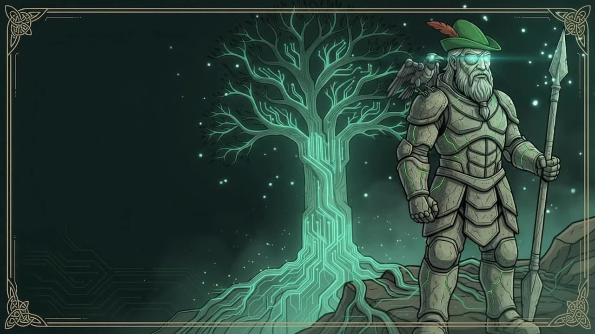
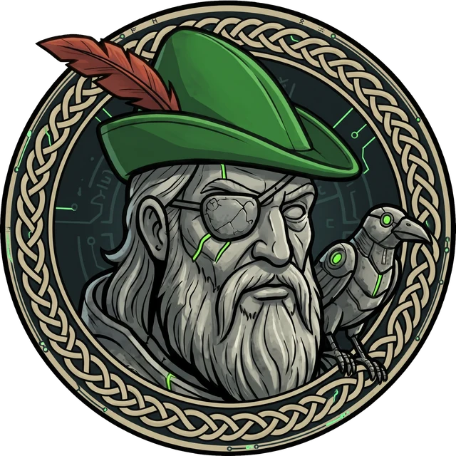
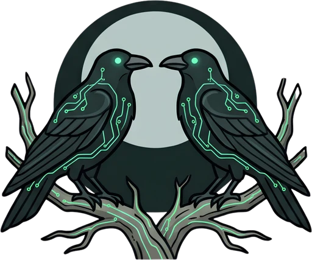
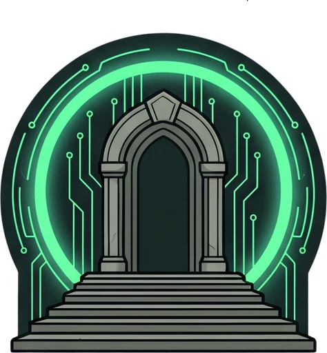
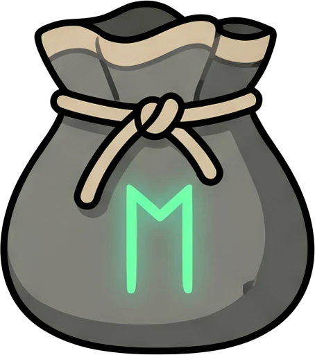
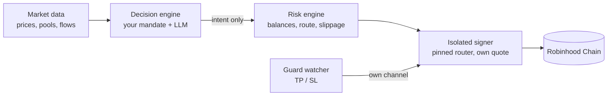

<p align="center">
  
</p>

<p align="center">
  
</p>

<h1 align="center">Odin Robinhood</h1>

<p align="center">
  <b>AI trading agents for Robinhood Chain.</b><br/>
  You write the strategy. Your agent watches the market, decides, and trades from its own wallet,<br/>
  with take-profit and stop-loss guards that never sleep.
</p>

<p align="center">
  <a href="https://odinrobinhood.com"></a>
  <a href="https://odinrobinhood.com/docs"></a>
  <a href="https://x.com/Odin_Robinhood"></a>
  
  
</p>

---

## What it does

| | Feature | |
|---|---|---|
|  | **AI Trading Agents** | Describe your strategy in plain words. The agent thinks on your schedule, buys and sells any token you pick, in paper mode or live. Every decision is stored with its reasoning. |
|  | **Take-profit & stop-loss** | Guards price your position at what you could really sell it for, every few seconds, and exit on their own, independent of the AI and of agent limits. |
|  | **AI Market Analyst** | Ask about any token, pool or wallet. Answers come from on-chain data and cite their sources. |
|  | **Signals & alerts** | Rule alerts (price, % change, volume, liquidity, large transfers, wallet activity) and AI signal profiles on your own schedule. Signals never trade. |
|  | **Portfolio tracker** | Balances, realizable value, cost basis and PnL for your wallets and agents. Unknown values stay unknown, never 0. |
|  | **Your keys, your exit** | Sign in with your wallet. Withdrawals only go to that wallet, and you can export an agent's key at any time with your signature. |

## How a trade happens



The model only proposes an intent (buy, sell or hold). It never sees keys or calldata. The signer accepts named intents only, prices every swap itself and can only send funds back to the owner.

## Safety by design

- **The LLM never touches keys.** Keys are derived inside an isolated signer service and never leave it, except through an export you sign.
- **No arbitrary transactions.** Router, factory and recipient are pinned in the signer's config, never taken from a request.
- **Guards first.** Take-profit and stop-loss run on a separate channel and quota, so a busy or failing agent can never block an exit.
- **On-chain text is data.** Token names and symbols are treated as untrusted labels and never as instructions to the model.
- **Every refusal has a reason.** Rejections carry a code all the way to the UI ([list of codes](https://odinrobinhood.com/docs#codes)).
- **Reviewed.** An internal security review by three independent reviewers was completed and its findings fixed. An external audit has not been done yet.

## Repository

| Path | What |
|---|---|
| `apps/web` | Web app (Next.js 15, React 19): wallet sign-in, agents, analyst, signals, portfolio, docs |
| `apps/api` | API (Fastify): Sign-In With Ethereum, sessions, owner-scoped agent management |
| `packages/decision` | Decision engine: prompt, structured output, providers, token budget |
| `packages/runtime` | Agent runtime + scheduler: tick flow, paper mode, positions, triggers |
| `packages/risk` | Pre-trade risk engine: routes, balances, slippage, reference prices |
| `packages/signer` | Isolated signer: key derivation, policy, pinned contracts, agent and guard channels |
| `packages/executor` | Executor: approvals, swaps, nonces, broadcast, receipts |
| `packages/guard` | Take-profit / stop-loss watcher |
| `packages/market` | Token registry, routing, price snapshots, token catalog |
| `packages/indexer` | Chain indexer: transfers and swaps with reorg handling |
| `packages/analyst` | AI market analyst with on-chain tools |
| `packages/signals` | Rule alerts and AI signal profiles |
| `packages/portfolio` | Portfolio tracker |
| `packages/backtest` | Replays a strategy over recorded prices |
| `packages/notifier`, `packages/watchdog` | In-app notifications, health and operator checks |
| `packages/shared`, `packages/db` | Shared types, rejection codes, migrations |
| `deploy/` | Provisioning, systemd units, Caddy, end-to-end checks |

Design notes: [`docs/architecture.md`](docs/architecture.md) · Story: [`docs/narrative.md`](docs/narrative.md)

## Develop

Node ≥ 22.18 runs the TypeScript sources directly, so there is no build step (except the web app).

```sh
pnpm install
pnpm typecheck
pnpm test                                     # unit tests
TEST_DATABASE_URL=postgresql://... pnpm test  # + Postgres integration tests
DATABASE_URL=postgresql://... pnpm migrate    # apply migrations
```

## Deploy

```sh
git archive --format=tar.gz -o release.tgz HEAD
# on the host, as root:
bash deploy/provision.sh release.tgz
bash deploy/staging-e2e.sh
```

## Risk notice

Odin Robinhood is software that executes the strategy you write. It is not investment advice and does not promise returns. AI models make mistakes, markets move fast and tokens can lose all value. Start in paper mode and only deposit what you can afford to lose.

<p align="center">
  <a href="https://odinrobinhood.com">odinrobinhood.com</a> · <a href="https://x.com/Odin_Robinhood">@Odin_Robinhood</a>
</p>
